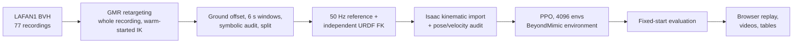

# Humanoid-Motion

An end-to-end pipeline that turns human motion capture into physically tracked motion on the Unitree G1 humanoid: retarget LAFAN1 recordings to the robot with GMR, audit every clip, train one multi-motion tracking policy with PPO in Isaac Lab, then evaluate it and replay the recorded physics.


*One policy on six held-out test clips, each tracked to the end. Rendered from recorded Isaac Lab states; nothing is re-simulated for the video.*

## Results (v0.1)

The released policy tracks **190 of 230** held-out LAFAN1 test clips (6 s each) without a failure, from a single attempt per clip.

| Category | Clips | Completed |
|---|---:|---:|
| aiming | 33 | 33 |
| walk | 63 | 62 |
| sprint | 8 | 8 |
| run | 22 | 19 |
| fightAndSports | 7 | 6 |
| dance | 25 | 21 |
| ground | 18 | 14 |
| fight | 16 | 12 |
| multipleActions | 10 | 5 |
| jumps | 17 | 7 |
| fallAndGetUp | 11 | 3 |
| **Total** | **230** | **190** |

On the 190 completed clips, the mean aligned body position error is **4.9 cm** (pose accuracy once heading and horizontal position are aligned) and the mean world root position error is **40.9 cm** (includes drift of the whole body in the world frame).

**Protocol.** Each test clip gets one attempt that starts from the clip's first reference frame, with no resets and no assistance. An attempt fails at the first frame where the torso height or any ankle or wrist height is more than 25 cm off the reference, or the torso tilt departs from the reference past BeyondMimic's threshold. Test clips are a contiguous block held out of every training recording, separated from training windows by a one-window gap.

**Where it is weak.** Jumps, falling and getting up, and clips that chain several actions. 39 of the 40 failures are an ankle or wrist ending up more than 25 cm above or below its reference height; one is the torso height.


*About 22 hours of training on one NVIDIA A40, run in segments that resume exactly from checkpoints: 4,096 parallel environments, 18,935 PPO updates, about 1.86 billion transitions.*

## Pipeline


*Left to right: LAFAN1 source joints, the G1 kinematic reference after retargeting, and the policy's execution in physics.*



**Data.** 77 LAFAN1 recordings are cut into 2,594 six-second windows, and 2,153 pass the audit. Rejection reasons (a window can have several): foot penetration over 5 cm (357), IK branch flips (139), joint speed over 40 rad/s (31), torso direction mismatch over 25° (22), joints pinned at a limit (13), a floating stance foot (1). Recordings that need scenery or external forces (obstacles, pushes) are retargeted but kept out of every split. The splits are train 1,062 clips (106 min), validation 75 and test 230 (23 min).

**Policy.** An MLP actor-critic (1024-1024-512-256, ELU). The actor sees ten future reference frames 0.1 s apart (joint positions and velocities, torso height, orientation and displacement in the reference's heading frame) and 0.2 s of proprioceptive history; it never sees the robot's world position. Rewards, failure terms, PD control and PPO settings are BeyondMimic's, unchanged. The end of a clip is treated as a time-out (bootstrapped), not a failure.

**Sampling.** Training episodes start at sampled clips and phases. Half of the probability is uniform; the other half follows each clip's recent failure rate, capped so every clip keeps between 0.5/N and 2/N. Within a clip, start phases are weighted the same way over 12 phase bins.

## What comes from upstream and what is written here

| Stage | Upstream, used unmodified | Written in this repository |
|---|---|---|
| Retargeting | [GMR](https://github.com/YanjieZe/GMR) IK and robot models | Batch driver; per-recording ground offset; windowing; audits: independent forward kinematics of the BVH and of the robot, CSV round-trip, joint limits, penetration, floating feet, IK flips, joint speed, torso mismatch; stratified split. Optional IK floor constraint, with a workaround for GMR's IK limits not reaching the solver under mink 0.0.13. |
| Reference preparation | BeyondMimic motion file format | 50 Hz resampling with SO(3) derivatives, independent URDF kinematics, Isaac kinematic import checked against it (1e-4 m / 1e-4 rad) |
| Training | [BeyondMimic](https://github.com/HybridRobotics/whole_body_tracking) environment, rewards, failure terms; [rsl_rl](https://github.com/leggedrobotics/rsl_rl) PPO; Isaac Lab | Multi-motion command over a clip library, failure-adaptive clip and phase sampling, future-window observation, time-out clip ends, exact resume (sampler, RNG and PPO's adaptive learning rate) |
| Evaluation and visualization | | Fixed-start evaluator, tracking metrics, browser replay of recorded physics, MuJoCo video rendering, result tables |

## Install

CPU environment for retargeting, viewers, videos and tests (macOS arm64 or Linux):

```bash
bash scripts/setup_cpu.sh
```

It creates `.venv` (Python 3.10), checks out GMR, BeyondMimic and LAFAN1 at the commits pinned in `configs/upstream_pins.json`, downloads LAFAN1 and the G1 description, and verifies their checksums.

GPU environment for import, training and evaluation (Linux, NVIDIA GPU with at least 24 GB, about 30 GB of disk):

```bash
bash scripts/setup_isaac.sh
```

It creates `.venv-isaac` with Isaac Sim 4.5.0, Isaac Lab 2.1.0, BeyondMimic and rsl_rl.

## Usage

Retarget one clip and inspect it in the browser (CPU, a few seconds):

```bash
.venv/bin/python scripts/retarget_clip.py
.venv/bin/python scripts/view_motion.py
```

Then open http://127.0.0.1:8080.

Build the full clip library (CPU; about 25 minutes with 32 workers):

```bash
.venv/bin/python scripts/prepare_lafan1.py --workers 32
```

Import it into Isaac, train and evaluate (GPU):

```bash
.venv-isaac/bin/python scripts/import_library.py --manifests train validation test --headless --device cuda:0
.venv-isaac/bin/python scripts/train.py --output outputs/train/g1 --train-hours 22 --headless --device cuda:0
.venv-isaac/bin/python scripts/evaluate.py --library outputs/lafan1/runtime/test.json --checkpoint outputs/train/g1/latest.pt --output outputs/eval/test --headless --device cuda:0
```

Training resumes from `latest.pt` when the same command is run again; `--train-hours` counts the total across resumes.

Summarize, replay and render an evaluation (CPU; copy `outputs/lafan1/runtime` and the evaluation folder from the GPU machine first):

```bash
.venv/bin/python scripts/summarize_results.py ours=outputs/eval/test
.venv/bin/python scripts/view_tracking.py --library outputs/lafan1/runtime/test.json --evaluation ours=outputs/eval/test
.venv/bin/python scripts/render_video.py grid --library outputs/lafan1/runtime/test.json --evaluation outputs/eval/test --clips dance2_subject2_f3720_3900 run1_subject5_f1560_1740 --webp outputs/videos/demo.webp
```

The replay viewer runs at http://127.0.0.1:8081. Repeat `--evaluation LABEL=DIR` to compare several policies clip by clip.

## Pretrained policy

The v0.1 checkpoint is attached to the [v0.1 release](https://github.com/seerier/Humanoid-Motion/releases) as `humanoid_motion_g1_v0.1.pt` (SHA256 `9e4fe7cf8857f3b676a3883b59c29c5891c1d93ccd25cf4575de99bb2aab863f`). Pass it to `scripts/evaluate.py --checkpoint`.

## Repository layout

```
src/humanoid_motion/
  contracts.py          named, SI, Z-up reference format shared by both stages
  retarget/gmr.py       GMR backend: retargeting, audits, optional floor constraint
  retarget/reference.py 50 Hz reference and independent URDF kinematics
  tracking/command.py   multi-motion command and adaptive sampling (BeyondMimic backend)
  tracking/observations.py, tracking/isaac_export.py, tracking/checks.py
  library.py, evaluation.py, geometry.py, urdf_kinematics.py
scripts/                setup, retarget_clip, prepare_lafan1, import_library, train, evaluate,
                        view_motion, view_tracking, render_video, summarize_results
tests/                  unit tests (pytest)
```

The two stages exchange only reference motion files, so either backend can be replaced without touching the other.

## Limitations

- Simulation only, in Isaac Lab; no sim-to-sim transfer or hardware deployment yet.
- One attempt per test clip from a nominal start; no perturbation or robustness study.
- Weak on jumps, falls and get-ups, and chained actions; noticeable world-frame drift.
- Flat ground, LAFAN1 only, Unitree G1 only.

## License and data

The code is MIT-licensed. LAFAN1 is CC BY-NC-ND 4.0, so the released checkpoint and videos are for non-commercial research use, with attribution to Ubisoft La Forge. Upstream components keep their own licenses; see [THIRD_PARTY.md](THIRD_PARTY.md).

## Acknowledgements

This project builds on [GMR](https://arxiv.org/abs/2510.02252) (Araújo et al., ICRA 2026), [BeyondMimic](https://arxiv.org/abs/2508.08241) (Liao et al., 2025), [LAFAN1](https://github.com/ubisoft/ubisoft-laforge-animation-dataset) (Harvey et al., SIGGRAPH 2020), [Isaac Lab](https://github.com/isaac-sim/IsaacLab) and [rsl_rl](https://github.com/leggedrobotics/rsl_rl).
