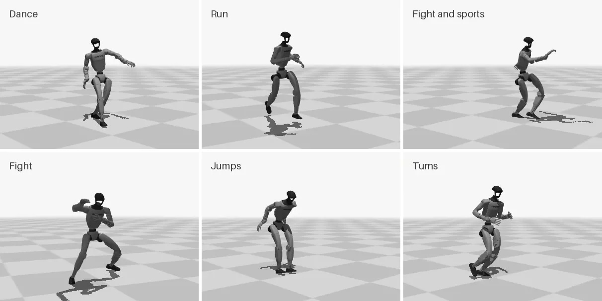
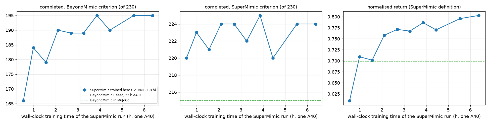
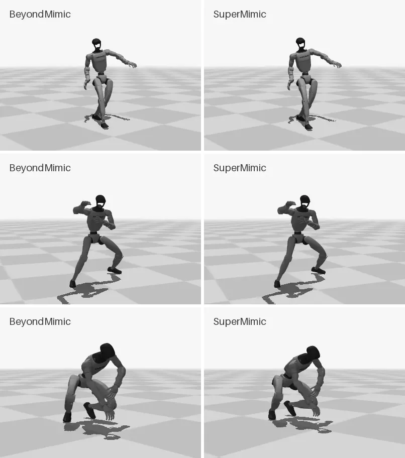
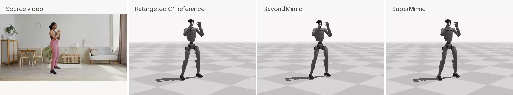
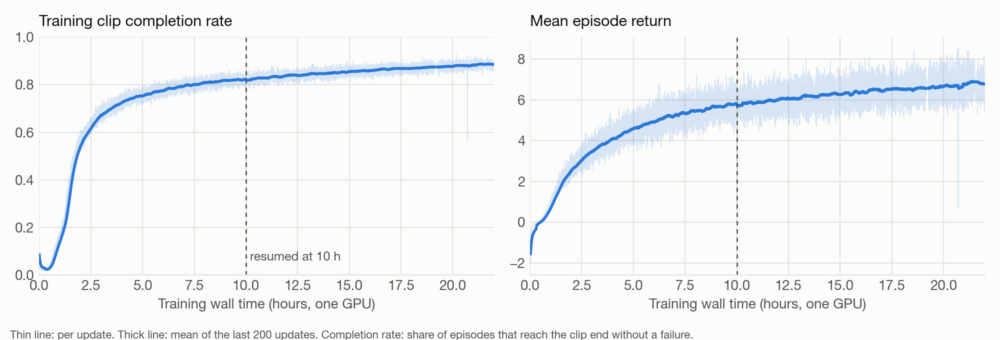
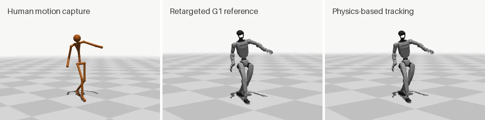
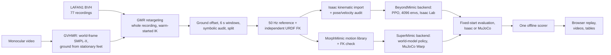

# Humanoid-Motion

An end-to-end pipeline that turns human motion, from motion capture or a single video, into physically tracked motion on the Unitree G1 humanoid: retarget it to the robot with GMR and audit every clip, track it with one of two physics backends (a multi-motion PPO policy in the BeyondMimic environment in Isaac Lab, or a SuperMimic world-model policy trained with MorphMimic's unofficial reimplementation in MuJoCo Warp), then score both with one evaluation protocol and replay the recorded physics.



*The BeyondMimic policy on six held-out test clips, each tracked to the end. Rendered from recorded Isaac Lab states; nothing is re-simulated for the video.*

## Two tracking backends, one scorer (v0.3)

The second backend follows SuperMimic (Liao et al., CoRL 2026), which learns a differentiable world model and trains the policy through it instead of with PPO. Its authors have not released code; this repository trains it with the open, unofficial reimplementation in MorphMimic's codebase, in single-robot mode, where MorphMimic's cross-embodiment additions are switched off (see [docs/supermimic.md](docs/supermimic.md)).

Both backends are scored by the same offline function on the same 230 held-out LAFAN1 test clips, from recorded states: one attempt per clip from its first frame, no resets, no assistance. "BeyondMimic criterion" fails an attempt at the first frame where the torso height or any ankle or wrist height is more than 25 cm off the reference, or the torso tilt passes BeyondMimic's threshold; the SuperMimic paper's criterion uses the torso terms only. The scorer reproduces the online Isaac evaluator exactly (190 / 230, the same first failure frame on every clip).

| Policy | Training | Simulator | Completed, BeyondMimic criterion | Completed, SuperMimic criterion |
|---|---|---|---:|---:|
| BeyondMimic (this repository, v0.1 release) | LAFAN1 train split (1,062 clips, 1.8 h of motion); 22 h on one A40 | Isaac Lab (its training simulator) | 190 | 216 |
| BeyondMimic, same policy | as above | MuJoCo (sim-to-sim) | 190 | 215 |
| SuperMimic (unofficial reimplementation), trained here | the same 1,062 clips; 6.4 h on one A40 | MuJoCo | **195** | **224** |

On the 183 clips all three completed, the mean aligned body position error is 4.7 / 4.8 / 3.4 cm and the mean world root position error 38.7 / 41.4 / 23.3 cm (rows 1 to 3). In MuJoCo, the mean normalised return over all 230 clips (the SuperMimic paper's benchmark definition: reward up to the torso-criterion failure, divided by the best possible return) is 0.698 for the BeyondMimic policy and 0.803 for the SuperMimic policy.



*Every 2,000th to 4,000th checkpoint of the SuperMimic run on the 230 test clips, against wall-clock time on one A40 (including compilation). Dashed: the BeyondMimic policy after 22 h of training, in Isaac Lab and in MuJoCo. A scheduler preemption stopped the run after 6.7 h; its last checkpoint (iteration 24,000, at 6.4 h) is the one reported, with no selection on the test set.*

What the numbers say, and what they do not:

- **Same data.** Both policies train on the same 1,062 LAFAN1 clips (the SuperMimic motion library is built from the same 50 Hz frames and checked against the same URDF kinematics). The SuperMimic policy reaches the BeyondMimic policy's 190 completions after about 2 h and ends 5 clips ahead, with lower pose and drift errors, after under a third of the training time.
- **Same engine.** The BeyondMimic policy also runs in the MuJoCo scene the SuperMimic policy is evaluated in (same PD gains, torque limits, action scale and control timing as the Isaac G1, observation rebuilt from the MuJoCo state). It completes 190 clips there, as in Isaac, with the same verdict on 226 of 230 clips, so rows 2 and 3 compare the policies in one engine. Every attempt in both simulators starts from the reference's first frame.
- **Not the algorithms alone.** The two training setups also differ in simulator (Isaac Lab against MuJoCo Warp), in what the policy sees (the SuperMimic goal includes the reference torso orientation relative to the robot's, read from the IMU; the BeyondMimic observation here does not, so its policy cannot see its heading error) and in randomisation (MorphMimic's defaults randomise the actuator delay between 0 and 40 ms). Neither policy sees its position offset from the reference. Each row is one training run and one evaluation.
- **Actuator delay.** With a 20 ms delay added in evaluation, the BeyondMimic policy drops from 190 to 161 completions and the SuperMimic policy from 195 to 193. The SuperMimic run trained with a random delay and the BeyondMimic policy without one, the likely reason for the gap; no control run isolates it.
- **Drift.** Both policies are blind to their world position by design. On the test clips the BeyondMimic policy's root drift is 1.7 to 1.8 times that of the SuperMimic policy; on the longer video clips below it is the other way round.
- **Where they fail.** Almost every failure is an ankle or wrist more than 25 cm off its reference height. The SuperMimic policy completes more falls and get-ups (7 against 3 of 11) and runs (22 against 19 in Isaac and 20 in MuJoCo, of 22), and slightly fewer jumps (6 against 7 of 17).
- **Paper settings.** A first SuperMimic run with every switch the paper gives a value for set to that value diverged near iteration 3,000 (critic loss up a hundredfold in 400 iterations, value estimate past the largest possible return); the reported run uses MorphMimic's own defaults, see [docs/supermimic.md](docs/supermimic.md).



*The same held-out clips tracked by the BeyondMimic policy (left, recorded in Isaac Lab) and the SuperMimic policy trained on the same data (right, recorded in MuJoCo); both complete all three.*

## From a single video (v0.3)

A monocular video goes through [GVHMR](https://github.com/zju3dv/GVHMR) (world-grounded SMPL-X human motion), a per-frame ground fix from GVHMR's own stationary-foot labels, and GMR, into a reference in the same format as the LAFAN1 clips; both trackers take it zero-shot, without training on it.



*Source video | retargeted G1 reference | BeyondMimic policy (Isaac Lab) | SuperMimic policy trained here (MuJoCo), first 12 s, both zero-shot. Video: Pexels (free licence).*

On three test videos (a squat from Pexels and two CMU Panoptic walking and gesturing windows), the BeyondMimic policy (in Isaac and in MuJoCo) and the SuperMimic policy each complete two, and both fail the third. On these 20 to 30 s clips, three to five times longer than the 6 s training windows, the mean root drift of the completed attempts is 35 to 47 cm for the BeyondMimic policy and 73 to 93 cm for the SuperMimic policy. The third video fails in retargeting, not tracking: GMR's inverse kinematics settles into a local minimum on the first frame and keeps one arm behind the back for the whole clip, and the stage audit (`humanoid_motion.video.stage_audit`) flags it at the retargeting stage. See [docs/video.md](docs/video.md).

## BeyondMimic backend results (v0.1)

The released policy tracks **190 of 230** held-out LAFAN1 test clips (6 s each) without a failure, from a single attempt per clip.

| Category | Clips | Completed |
|---|---:|---:|
| aiming | 33 | 33 |
| walk | 63 | 62 |
| sprint | 8 | 8 |
| run | 22 | 19 |
| fightAndSports | 7 | 6 |
| dance | 25 | 21 |
| ground | 18 | 14 |
| fight | 16 | 12 |
| multipleActions | 10 | 5 |
| jumps | 17 | 7 |
| fallAndGetUp | 11 | 3 |
| **Total** | **230** | **190** |

On the 190 completed clips, the mean aligned body position error is **4.9 cm** (pose accuracy once heading and horizontal position are aligned) and the mean world root position error is **40.9 cm** (includes drift of the whole body in the world frame).

**Protocol.** Each test clip gets one attempt that starts from the clip's first reference frame, with no resets and no assistance. An attempt fails at the first frame where the torso height or any ankle or wrist height is more than 25 cm off the reference, or the torso tilt departs from the reference past BeyondMimic's threshold. Test clips are a contiguous block held out of every training recording, separated from training windows by a one-window gap.

**Where it is weak.** Jumps, falling and getting up, and clips that chain several actions. 39 of the 40 failures are an ankle or wrist ending up more than 25 cm above or below its reference height; one is the torso height.



*About 22 hours of training on one NVIDIA A40, run in segments that resume exactly from checkpoints: 4,096 parallel environments, 18,935 PPO updates, about 1.86 billion transitions.*

## Pipeline



*Left to right: LAFAN1 source joints, the G1 kinematic reference after retargeting, and the policy's execution in physics.*



**Data.** 77 LAFAN1 recordings are cut into 2,594 six-second windows, and 2,153 pass the audit. Rejection reasons (a window can have several): foot penetration over 5 cm (357), IK branch flips (139), joint speed over 40 rad/s (31), torso direction mismatch over 25° (22), joints pinned at a limit (13), a floating stance foot (1). Recordings that need scenery or external forces (obstacles, pushes) are retargeted but kept out of every split. The splits are train 1,062 clips (106 min), validation 75 and test 230 (23 min).

**Policy.** An MLP actor-critic (1024-1024-512-256, ELU). The actor sees ten future reference frames 0.1 s apart (joint positions and velocities, torso height, orientation and displacement in the reference's heading frame) and 0.2 s of proprioceptive history; it never sees the robot's world position. Rewards, failure terms, PD control and PPO settings are BeyondMimic's, unchanged. The end of a clip is treated as a time-out (bootstrapped), not a failure.

**Sampling.** Training episodes start at sampled clips and phases. Half of the probability is uniform; the other half follows each clip's recent failure rate, capped so every clip keeps between 0.5/N and 2/N. Within a clip, start phases are weighted the same way over 12 phase bins.

## What comes from upstream and what is written here

| Stage | Upstream, used unmodified | Written in this repository |
|---|---|---|
| Retargeting | [GMR](https://github.com/YanjieZe/GMR) IK and robot models | Batch driver; per-recording ground offset; windowing; audits: independent forward kinematics of the BVH and of the robot, CSV round-trip, joint limits, penetration, floating feet, IK flips, joint speed, torso mismatch; stratified split. Optional IK floor constraint, with a workaround for GMR's IK limits not reaching the solver under mink 0.0.13. |
| Reference preparation | BeyondMimic motion file format | 50 Hz resampling with SO(3) derivatives, independent URDF kinematics, Isaac kinematic import checked against it (1e-4 m / 1e-4 rad) |
| Training | [BeyondMimic](https://github.com/HybridRobotics/whole_body_tracking) environment, rewards, failure terms; [rsl_rl](https://github.com/leggedrobotics/rsl_rl) PPO; Isaac Lab | Multi-motion command over a clip library, failure-adaptive clip and phase sampling, future-window observation, time-out clip ends, exact resume (sampler, RNG and PPO's adaptive learning rate) |
| Evaluation and visualization | | Fixed-start evaluator, tracking metrics, browser replay of recorded physics, MuJoCo video rendering, result tables |
| Video front end (v0.3) | [GVHMR](https://github.com/zju3dv/GVHMR) demo and weights; [SMPL-X](https://smpl-x.is.tue.mpg.de/) body model | GVHMR-to-SMPL-X adapter (parameter-level axis change checked against the body model), per-frame ground from GVHMR's stationary-foot labels, quality gate, stage-by-stage audit, SMPL-X source for GMR |
| SuperMimic backend (v0.3) | [MorphMimic](https://github.com/lzyang2000/morphmimic) training, export and sim2sim code; [mjlab](https://github.com/mujocolab/mjlab) | Motion-library conversion from the same frames with an FK check, switch settings, exporter adapter for motion-only runs, in-process sim2sim evaluator, SuperMimic's normalised return |
| Comparison (v0.3) | | One offline scorer for both backends, verified against the online evaluator; the BeyondMimic policy in MuJoCo for a same-engine comparison |

## Install

CPU environment for retargeting, viewers, videos and tests (macOS arm64 or Linux):

```bash
bash scripts/setup_cpu.sh
```

It creates `.venv` (Python 3.10), checks out GMR, BeyondMimic and LAFAN1 at the commits pinned in `configs/upstream_pins.json`, downloads LAFAN1 and the G1 description, and verifies their checksums.

GPU environment for import, training and evaluation (Linux, NVIDIA GPU with at least 24 GB, about 30 GB of disk):

```bash
bash scripts/setup_isaac.sh
```

It creates `.venv-isaac` with Isaac Sim 4.5.0, Isaac Lab 2.1.0, BeyondMimic and rsl_rl.

Optional, for the video front end (GVHMR in its own conda environment; you register for and download the SMPL and SMPL-X body models yourself, see [docs/video.md](docs/video.md)):

```bash
bash scripts/setup_gvhmr.sh
```

Optional, for the SuperMimic backend (MorphMimic's own locked environment, Python 3.11, about 9 GB):

```bash
bash scripts/setup_supermimic.sh
```

## Usage

Retarget one clip and inspect it in the browser (CPU, a few seconds):

```bash
.venv/bin/python scripts/retarget_clip.py
.venv/bin/python scripts/view_motion.py
```

Then open http://127.0.0.1:8080.

Build the full clip library (CPU; about 25 minutes with 32 workers):

```bash
.venv/bin/python scripts/prepare_lafan1.py --workers 32
```

Import it into Isaac, train and evaluate (GPU):

```bash
.venv-isaac/bin/python scripts/import_library.py --manifests train validation test --headless --device cuda:0
.venv-isaac/bin/python scripts/train.py --output outputs/train/g1 --train-hours 22 --headless --device cuda:0
.venv-isaac/bin/python scripts/evaluate.py --library outputs/lafan1/runtime/test.json --checkpoint outputs/train/g1/latest.pt --output outputs/eval/test --headless --device cuda:0
```

Training resumes from `latest.pt` when the same command is run again; `--train-hours` counts the total across resumes.

Summarize, replay and render an evaluation (CPU; copy `outputs/lafan1/runtime` and the evaluation folder from the GPU machine first):

```bash
.venv/bin/python scripts/summarize_results.py ours=outputs/eval/test
.venv/bin/python scripts/view_tracking.py --library outputs/lafan1/runtime/test.json --evaluation ours=outputs/eval/test
.venv/bin/python scripts/render_video.py grid --library outputs/lafan1/runtime/test.json --evaluation outputs/eval/test --clips dance2_subject2_f3720_3900 run1_subject5_f1560_1740 --webp outputs/videos/demo.webp
```

The replay viewer runs at http://127.0.0.1:8081. Repeat `--evaluation LABEL=DIR` to compare several policies clip by clip.

From a video to a reference both trackers accept (see [docs/video.md](docs/video.md)):

```bash
GVHMR_PYTHON=<GVHMR env>/bin/python .venv/bin/python scripts/video_to_reference.py --video squat.mp4 --manifest video
.venv-isaac/bin/python scripts/import_library.py --manifests video --data-root outputs/video --headless --device cuda:0
```

SuperMimic backend (see [docs/supermimic.md](docs/supermimic.md)); `MM` is MorphMimic's interpreter:

```bash
MM=third_party/morphmimic/.venv/bin/python
PYTHONPATH=src $MM -m humanoid_motion.tracking.supermimic.library --split outputs/lafan1/train.json --out outputs/supermimic/library/train
$MM -m morphmimic.scripts.train --robot g1 --subset-yaml outputs/supermimic/library/train/subsets/train.yaml --gpu 0 \
   --ckpt-every 2000 --log-dir outputs/supermimic/runs --run-name lafan1
PYTHONPATH=src $MM -m humanoid_motion.tracking.supermimic.export outputs/supermimic/runs/lafan1/ckpt_24000.pt outputs/supermimic/export/lafan1
```

This is the reported run, on MorphMimic's defaults; the switch flags that set the paper's values instead are listed in [docs/supermimic.md](docs/supermimic.md).

Evaluate either backend in MuJoCo, score with one function, and render side by side (the MuJoCo scene and clips come from MorphMimic's `deploy.sim2sim.export_assets`):

```bash
PYTHONPATH=src $MM scripts/evaluate_mujoco.py --policy supermimic --deploy outputs/supermimic/export/lafan1 --assets outputs/supermimic/assets/test \
   --library outputs/lafan1/runtime/test.json --output outputs/eval/supermimic_test
PYTHONPATH=src $MM scripts/evaluate_mujoco.py --policy beyondmimic --checkpoint humanoid_motion_g1_v0.1.pt --assets outputs/supermimic/assets/test \
   --library outputs/lafan1/runtime/test.json --output outputs/eval/beyondmimic_mujoco_test
.venv/bin/python scripts/score_rollouts.py --library outputs/lafan1/runtime/test.json --evaluation outputs/eval/test --check
.venv/bin/python scripts/render_video.py compare --library outputs/lafan1/runtime/test.json \
   --compare BeyondMimic=outputs/eval/test SuperMimic=outputs/eval/supermimic_test --clips dance2_subject2_f3720_3900
```

## Pretrained policy

The v0.1 checkpoint is attached to the [v0.1 release](https://github.com/seerier/Humanoid-Motion/releases) as `humanoid_motion_g1_v0.1.pt` (SHA256 `9e4fe7cf8857f3b676a3883b59c29c5891c1d93ccd25cf4575de99bb2aab863f`). Pass it to `scripts/evaluate.py --checkpoint`.

## Repository layout

```
src/humanoid_motion/
  contracts.py          named, SI, Z-up reference format shared by both stages
  retarget/gmr.py       GMR backend: retargeting, audits, optional floor constraint
  retarget/reference.py 50 Hz reference and independent URDF kinematics
  tracking/command.py   multi-motion command and adaptive sampling (BeyondMimic backend)
  tracking/observations.py, tracking/isaac_export.py, tracking/checks.py
  tracking/sim2sim.py   MuJoCo evaluation harness for both backends; the BeyondMimic policy outside Isaac
  tracking/supermimic/  SuperMimic backend: motion library, exporter adapter, sim2sim player, normalised return
  retarget/sources.py   source loaders: LAFAN1 BVH, AMASS-style SMPL-X
  video/                video front end: GVHMR adapter, quality gate, stage audit, FK check
  library.py, evaluation.py (metrics and the offline scorer), geometry.py, urdf_kinematics.py
scripts/                setup, retarget_clip, prepare_lafan1, video_to_reference, import_library, train, evaluate,
                        evaluate_mujoco, score_rollouts, view_motion, view_tracking, render_video, summarize_results
tests/                  unit tests (pytest)
```

The two stages exchange only reference motion files, so either backend can be replaced without touching the other.

## Limitations

- Simulation only: Isaac Lab and MuJoCo (sim-to-sim for the BeyondMimic policy); no hardware deployment.
- One attempt per test clip from a nominal start; the only robustness test is a fixed 20 ms actuator delay.
- The SuperMimic backend is an unofficial reimplementation; its results say how this implementation performs on this data, not how the authors' code would.
- Every policy is weakest on jumps and chained actions (the BeyondMimic policy also on falls and get-ups), and every policy drifts in the world frame.
- Video references are only as good as the monocular reconstruction and the retargeting: three test videos, one of which fails in retargeting.
- Flat ground, Unitree G1 only.

## License and data

The code is MIT-licensed. LAFAN1 is CC BY-NC-ND 4.0, so the released checkpoint and videos are for non-commercial research use, with attribution to Ubisoft La Forge. GVHMR and the SMPL-X model are for non-commercial research only and are not redistributed. Upstream components keep their own licenses; see [THIRD_PARTY.md](THIRD_PARTY.md).

## Acknowledgements

This project builds on [GMR](https://arxiv.org/abs/2510.02252) (Araújo et al., ICRA 2026), [BeyondMimic](https://arxiv.org/abs/2508.08241) (Liao et al., 2025), [SuperMimic](https://arxiv.org/abs/2610.28480) (Liao et al., CoRL 2026) through the open [MorphMimic](https://github.com/lzyang2000/morphmimic) implementation (Yang et al., 2026), [GVHMR](https://github.com/zju3dv/GVHMR) (Shen et al., SIGGRAPH Asia 2024), [SMPL-X](https://smpl-x.is.tue.mpg.de/), [LAFAN1](https://github.com/ubisoft/ubisoft-laforge-animation-dataset) (Harvey et al., SIGGRAPH 2020), [mjlab](https://github.com/mujocolab/mjlab), [MuJoCo](https://github.com/google-deepmind/mujoco), [Isaac Lab](https://github.com/isaac-sim/IsaacLab) and [rsl_rl](https://github.com/leggedrobotics/rsl_rl).
