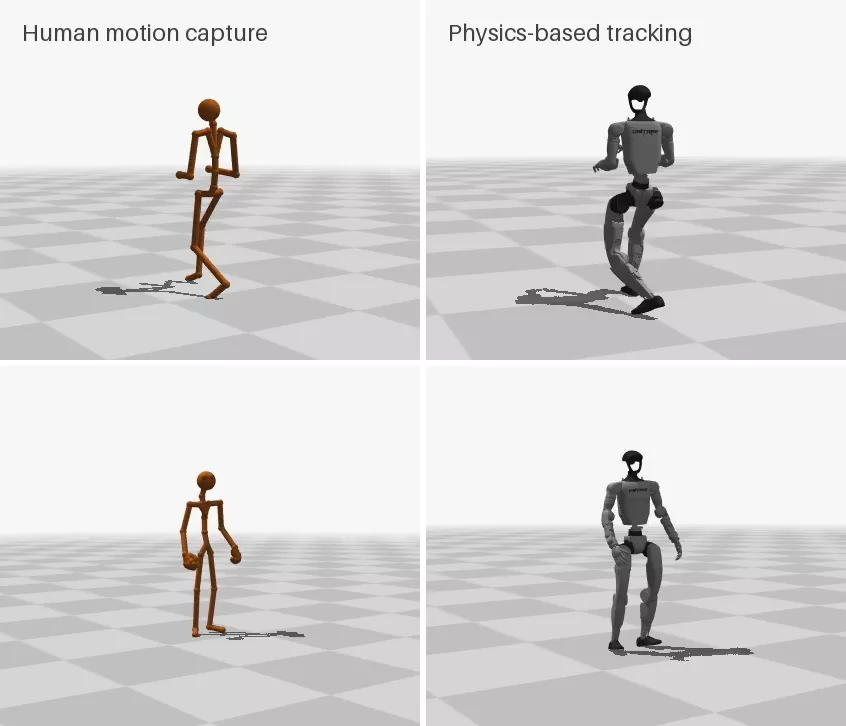

# Acrobatics

Thirteen hand-picked acrobatic segments (cartwheels, a kip-up, a backward roll, a side flip, standing and running backflips, a front handspring and a breakdance sequence with flips), retargeted to the Unitree G1 with a whole-body floor constraint and learned by multi-clip BeyondMimic-environment policies, and by single-clip policies for some of the segments those do not finish. Four of the thirteen are tracked to the end. **These are training clips**: each policy is evaluated on the clips it was trained on, so the numbers say what it can track, not how it generalizes. The held-out results of the main README are a separate experiment.

```
segment spec -> plain GMR -> ground offset -> GMR with every collision geom kept above the floor -> lowered to z = 0
             -> 50 Hz reference + URDF FK -> Isaac import -> train.py (multi-clip PPO) -> evaluate.py
```

## Why a separate path

`scripts/prepare_lafan1.py` cuts each LAFAN1 recording into 6 s windows and rejects any window whose feet go more than 5 cm into the floor. Plain GMR puts hands, feet and knees through the floor during cartwheels and get-ups, so the LAFAN1 cartwheels and most kip-ups never reach the training library, and the v0.1 policy has not seen them. LAFAN1 also has no flips. `scripts/prepare_segments.py` takes a list of named segments instead, from LAFAN1 BVH, AMASS-style SMPL-X or CMU ASF/AMC, and retargets each one with GMR's IK floor constraint applied to every collision geom of the robot (`floor_limit` with `geoms: collision`: 24 meshes, the 8 sole spheres and the 4 shoulder cylinders), not only the soles.

## Data

- **LAFAN1**: fetched by `scripts/setup_cpu.sh` into `data/lafan1.zip`; a spec entry `"source_file": "lafan1:<stem>"` reads `<stem>.bvh` from the archive.
- **AMASS, CMU subset, SMPL-X N**: register at <https://amass.is.tue.mpg.de>, download the CMU archive of the SMPL-X N release, and unpack it so that `data/amass/CMU/<subject>/<trial>_stageii.npz` exists (`data/amass` may be a symlink). The SMPL-X body model is needed as for the video front end ([docs/video.md](video.md)).
- **CMU Graphics Lab, original ASF/AMC**: the standing backflips 87_03, 87_04 and 88_01 are not in AMASS. Download `87.asf`, `87_03.amc`, `87_04.amc`, `88.asf` and `88_01.amc` from `http://mocap.cs.cmu.edu/subjects/<subject>/` into `data/cmu_mocap/<subject>/`.

CMU trial names below are the descriptions on <http://mocap.cs.cmu.edu>.

| Segment | Source | Window | Length |
|---|---|---|---:|
| `lafan1_cartwheel_a` | LAFAN1 `dance1_subject1` | 104.0-110.0 s | 6.0 s |
| `lafan1_kipup_a` | LAFAN1 `fallAndGetUp2_subject3` | 38.5-44.5 s | 6.0 s |
| `lafan1_roll_c` | LAFAN1 `fallAndGetUp2_subject3`, backward roll to standing | 82.5-88.5 s | 6.0 s |
| `cmu_90_08_side_flip` | CMU 90_08 "side flip" | whole trial | 5.6 s |
| `cmu_88_05_cartwheel_backflip` | CMU 88_05 "cartwheel into backflip" | whole trial | 2.5 s |
| `cmu_90_19_monkey_backflip` | CMU 90_19 "monkey backflip" | whole trial | 8.6 s |
| `cmu_88_08_crouch_flip_back` | CMU 88_08 "crouch and flip back" | whole trial | 4.8 s |
| `cmu_90_02_cartwheel` | CMU 90_02 "cartwheel" | whole trial | 6.5 s |
| `cmu_90_14_front_handspring` | CMU 90_14 "front hand flip" | whole trial | 7.0 s |
| `cmu_85_14_flips_a` | CMU 85_14 "BreakSequencewithFlips" | 9.0-13.5 s | 4.5 s |
| `cmu_88_01_backflip` | CMU 88_01 "backflip", ASF/AMC | 0-3.35 s | 3.4 s |
| `cmu_87_03_backflip` | CMU 87_03 "Backflip", ASF/AMC | 0-4.1 s | 4.1 s |
| `cmu_87_04_backflip` | CMU 87_04 "backflip", ASF/AMC | 0-3.58 s | 3.6 s |

The spec is `configs/segments/acrobatics_v2.json` (the first ten segments alone are `acrobatics.json`).

**CMU ASF/AMC.** `humanoid_motion.retarget.asf_amc` reads the Acclaim files and hands GMR frames in the joint conventions of its LAFAN1 loader, so GMR's `bvh_lafan1` table retargets them unmodified. Two corrections to the recorded data, both counted or documented per run: the toe frames follow the foot bone with the toe joint at rest (the recorded toe angles are 30-60 degrees off while the subject stands still), and two-angle joints that jump to the other Euler branch (both angles shifted by 180 degrees, which turns the foot backwards in 88_01) are put back. Checked against the AMASS fits of the same recordings (88_05, 88_08, 90_08): joint positions agree to 3-11 cm median, the difference between the two skeleton models, and on 88_05 GMR's IK error is 0.93 from the ASF/AMC and 0.90 from AMASS (`configs/segments/cmu_backflips.json` has the 88_05 check segment). The subject heights are the AMASS mesh statures of the same subjects (88_05, 87_01).

## Use

```bash
# References (CPU, a few minutes with 16 workers), then the Isaac import (GPU); the same for acrobatics.json
.venv/bin/python scripts/prepare_segments.py --spec configs/segments/acrobatics_v2.json --out outputs/acro/library_v2 \
   --manifest acrobatics_v2 --workers 16
.venv-isaac/bin/python scripts/import_library.py --manifests acrobatics_v2 --data-root outputs/acro/library_v2 \
   --headless --device cuda:0
# 10 segments from scratch, then 13 segments from that policy (7 h each)
.venv-isaac/bin/python scripts/train.py --library outputs/acro/library/runtime/acrobatics.json --output outputs/train/acro10 \
   --train-hours 7 --headless --device cuda:0
.venv-isaac/bin/python scripts/train.py --library outputs/acro/library_v2/runtime/acrobatics_v2.json \
   --output outputs/train/acro13 --init-from outputs/train/acro10/latest.pt --train-hours 7 --headless --device cuda:0
# Single clip: a manifest with one row of the imported library, 4 h from the 10-segment policy
python3 - <<'EOF'
import json, pathlib
m = json.loads(pathlib.Path('outputs/acro/library_v2/runtime/acrobatics_v2.json').read_text())
m['clips'] = [c for c in m['clips'] if c['id'] == 'cmu_88_08_crouch_flip_back']
pathlib.Path('outputs/acro/solo').mkdir(parents=True, exist_ok=True)
pathlib.Path('outputs/acro/solo/cmu_88_08_crouch_flip_back.json').write_text(json.dumps(m, indent=1))
EOF
.venv-isaac/bin/python scripts/train.py --library outputs/acro/solo/cmu_88_08_crouch_flip_back.json \
   --output outputs/train/solo_88_08 --init-from outputs/train/acro10/latest.pt --train-hours 4 --headless --device cuda:0
# Evaluate on the training segments, one attempt each from the first frame
.venv-isaac/bin/python scripts/evaluate.py --library outputs/acro/library_v2/runtime/acrobatics_v2.json \
   --checkpoint outputs/train/acro13/latest.pt --output outputs/eval/acro13 --headless --device cuda:0
```

Each segment gets `<out>/<id>/`:

| Path | Contents |
|---|---|
| `plain/` | GMR without the floor constraint |
| `floor/` | GMR with the whole-body floor constraint at the ground offset |
| `gmr/` | the `floor/` run lowered so that the floor is z = 0 (what the rest of the pipeline reads) |
| `prepared/` | 50 Hz reference and independent URDF FK |
| `segment.json` | ground offset, audit numbers, manifest row |

**Choices.**
- GMR settings: LAFAN1 and ASF/AMC segments use `configs/walk1_s1.json`; SMPL-X segments use the video front end's GMR settings without its floor (subject mesh stature as the human height), at a GMR target rate of 60 Hz (`--smplx-fps`). Both use up to 200 IK iterations on the first frame.
- Ground offset: the median lowest-sole height of plain GMR over frames where the human stands (`prepare_lafan1.ground_offset`), one constant per segment.
- Floor constraint: GMR's velocity-damper floor limit with gain 0.85, zero minimum distance and 10 cm detection distance, at the ground offset, over every collision geom.
- Audit: lowest body point, lowest sole, joint speed, URDF limit excess, IK error. Every segment is kept; the audit only reports. After the floor constraint the lowest body point of every segment is within 1.1 mm of the floor.

## Results



*Top: the LAFAN1 cartwheel, tracked by the 13-segment policy. Bottom: CMU 88_08 ("crouch and flip back"), a back handspring, tracked by its single-clip policy. Both policies were trained on these clips. Rendered from recorded Isaac Lab states.*

Three training runs, all with `scripts/train.py` (the BeyondMimic environment, multi-clip PPO with failure-adaptive clip and phase sampling, 4,096 environments) and 7 or 4 h of wall-clock budget on one GPU:

- **10 segments**: the first ten segments, from scratch, 7 h on an L40S (7,513 updates).
- **13 segments**: all thirteen, `--init-from` the 10-segment policy, 7 h on an L40S (7,762 updates).
- **Single clip**: one segment each, `--init-from` the 10-segment policy, 4 h on an A40 or L40S. Run for four CMU segments the 10-segment policy does not track (88_01 is not among its ten).

Each policy is evaluated with `scripts/evaluate.py` on its training segments: one attempt per segment from its first frame, stopped at the first failure under the BeyondMimic criterion (torso, ankle or wrist height more than 25 cm off the reference, or the torso tilt). The table gives the share of the segment tracked before the first failure.

| Segment | 10 segments | 13 segments | Single clip |
|---|---:|---:|---:|
| `lafan1_cartwheel_a` | **complete** | **complete** | |
| `lafan1_kipup_a` | **complete** | **complete** | |
| `lafan1_roll_c` | **complete** | **complete** | |
| `cmu_90_08_side_flip` | 60 % | 63 % | 64 % |
| `cmu_88_05_cartwheel_backflip` | 13 % | 15 % | |
| `cmu_90_19_monkey_backflip` | 47 % | 66 % | |
| `cmu_88_08_crouch_flip_back` | 61 % | 61 % | **complete** |
| `cmu_90_02_cartwheel` | 53 % | 54 % | |
| `cmu_90_14_front_handspring` | 61 % | 61 % | 62 % |
| `cmu_85_14_flips_a` | 38 % | 47 % | |
| `cmu_88_01_backflip` | | 26 % | 27 % |
| `cmu_87_03_backflip` | | 59 % | |
| `cmu_87_04_backflip` | | 57 % | |

Four of the thirteen segments are tracked to the end. Neither LAFAN1 policy of the earlier releases tracks any of them: the v0.1 BeyondMimic policy completes 0 of the first ten in Isaac Lab, the v0.3 SuperMimic policy 0 of 13 in MuJoCo.

**Where the flips fail.** In most CMU segments the first failure stays at the same moment from run to run: the side flip at frame 166, 175 and 177 of 279 in the three runs, the front handspring at 211, 212 and 215 of 348. The monkey backflip and the breakdance segment get further in the 13-segment run (47 to 66 %, 38 to 47 %). The single-clip runs on the side flip and on 88_01 stopped improving within their first half hour (training-time completion flat at 0.45 and 0.52 for the remaining 3.5 h). From the recorded rollouts of the single-clip policies:

- **Take-off** (side flip, 88_01): the reference pelvis leaves the ground at 2.0 and 2.8 m/s upwards; the robot's reaches 0.8 and 1.4 m/s, stays 16-26 cm below the reference, and an ankle drops more than 25 cm below its reference height. The knees are far from their limits at the push-off (88_01: 44 of 139 N·m; side flip: up to 90), while the side flip holds the waist pitch at its 50 N·m limit. The legs have torque to spare, so the policy has not found a harder take-off within the 25 cm tolerance; whether one exists that the G1 model can execute is not tested.
- **Hand support** (front handspring): the push-off holds the ankle and waist pitch at their 50 N·m limits, the robot does not rise with the reference, and in the hand support its wrists are at their 5 N·m limit while the pelvis sinks 22 cm below the reference.

## Licences

Nothing below is redistributed by this repository: not the source motions, not the retargeted references.

- **AMASS**: licence for non-commercial scientific research, education and artistic projects; it also prohibits using the dataset to train networks for commercial use, and the dataset may not be shared with third parties. Cite Mahmood et al., *AMASS: Archive of Motion Capture as Surface Shapes*, ICCV 2019.
- **CMU Graphics Lab Motion Capture Database** (the original recordings behind the AMASS CMU subset, and the ASF/AMC files used directly): "free for all uses"; the CMU site asks for the acknowledgement "The data used in this project was obtained from mocap.cs.cmu.edu. The database was created with funding from NSF EIA-0196217."
- **LAFAN1**: CC BY-NC-ND 4.0.
- **SMPL-X**: Max Planck licence for non-commercial scientific research.

Policies and videos made from these segments are therefore for non-commercial research use only.
