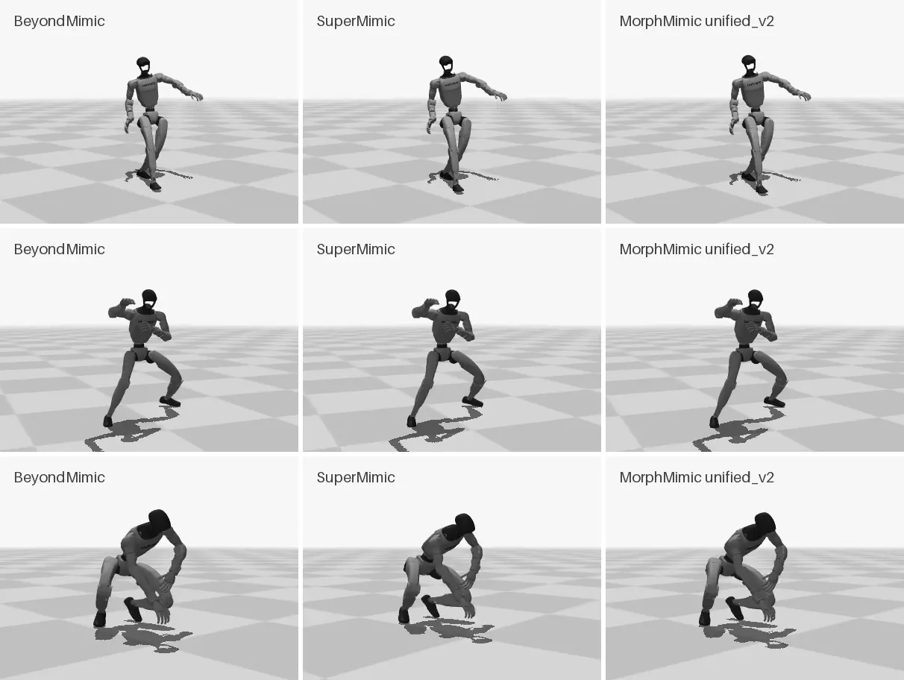

# SuperMimic tracking backend

[SuperMimic](https://arxiv.org/abs/2610.28480) (Liao et al., CoRL 2026) trains a motion-tracking policy by backpropagating through a learned, differentiable world model instead of using PPO. Its authors have not released code. This repository uses the open, unofficial reimplementation in [MorphMimic](https://github.com/lzyang2000/morphmimic) (Yang et al., 2026; Apache-2.0), pinned at commit `2e35049`, with its code unmodified (the policy reported here was trained and evaluated at `8cd92b6`, which a later force push removed from MorphMimic's main branch; `2e35049` has the same code and differs only in README.md). MorphMimic's README states that its SuperMimic base was written from the paper alone and is not reviewed or endorsed by the SuperMimic authors. On top of it MorphMimic adds cross-embodiment training (a morphology input, decoder FiLM, latent alignment, shared modules across robots) and a five-point teleoperation interface. This repository trains in single-robot mode (`--robot g1`, no `--robots`), where `Trainer._resolve_cfg` leaves the morphology input off, turns FiLM off and sets the latent-alignment weight to zero, and without `--kp-interface`; the G1 is MorphMimic's canonical 29-joint layout, so its joint map is the identity. What remains is MorphMimic's reading of the SuperMimic paper, with the switches below. MorphMimic runs on [mjlab](https://github.com/mujocolab/mjlab) (MuJoCo Warp).

What this repository adds around it (`src/humanoid_motion/tracking/supermimic/`):

- `library.py`: converts the prepared LAFAN1 (or video) references into MorphMimic's motion library. It uses the same 50 Hz frames as the Isaac library of the BeyondMimic backend, and MorphMimic's own forward kinematics and finite differences on mjlab's G1 model. Every clip is checked against the independent URDF forward kinematics (largest difference on the LAFAN1 splits: 5.7e-7 m, 1.5e-6 rad). MorphMimic's name and feasibility filters are recorded but do not drop clips (8 of the 1,062 training clips would fail its feasibility filter), so both backends train on exactly the same clips.
- `evaluate.py` and `src/humanoid_motion/tracking/sim2sim.py`: play exported policies in MorphMimic's CPU MuJoCo sim2sim scene and write the same files as `scripts/evaluate.py`, so one offline scoring function covers both backends (`scripts/evaluate_mujoco.py`, `scripts/score_rollouts.py`).
- `returns.py`: SuperMimic's normalised return (the paper's benchmark definition) of saved rollouts.

## Switch list

Training uses MorphMimic's command-line flags only. A first LAFAN1 run set every switch for which the paper gives a value to the paper's value (column "Run 1") and kept MorphMimic's defaults for the paper's gaps. It diverged near iteration 3,000: the critic loss rose from 0.026 at iteration 2,750 to 7.5 at 3,200, the critic's mean value at the start of imagined rollouts rose from 6.7 to 14.6, past the largest possible return (10), and the episode length and return fell; the run was stopped there and had no checkpoint from before the divergence. The policy reported here (column "Run 2") is trained with MorphMimic's own defaults throughout, rather than a mix of the two.

| Item | Paper | MorphMimic default | Run 1 (diverged) | Run 2 (reported) | Flag for the paper value |
|---|---|---|---|---|---|
| World-model MLP | plain (2048, 2048, 2048) (Table A.4) | LayerNorm after each hidden layer | plain | LayerNorm | `--no-wm-layer-norm` |
| Critic MLP | plain (256, 128) (Table A.4) | LayerNorm after each hidden layer | plain | LayerNorm | `--no-critic-layer-norm` |
| Critic targets | TD(λ) targets of Eq. 3, unclamped | clamped at 10 (largest possible return) | unclamped | clamped | `--no-critic-target-clip` |
| World-model-only warm phase | none: all networks update every iteration (Alg. A.1) | 500 iterations | none | 500 iterations | `--wm-only-iters 0` |
| Actuator delay | none (Table A.3) | random 0 to 40 ms | none | 0 to 40 ms | `--no-actuator-delay` |
| Imagination start states | any replay state | at least H + K frames before the clip end | any replay state | away from clip ends | `--no-avoid-clip-end` |
| Precision | TF32 | bfloat16 autocast | TF32 | bfloat16 | `--no-bf16` |
| World-model residual scale | not given | one-step RMS of the warm-up replay | default | default | |
| World-model frame | not given | pelvis frame plus gravity and body heights | default | default | |
| Termination head | learned, form not given | hazard model on the two termination margins | default | default | |
| Reset-sampler return normalisation | not given | best return still reachable | default | default | |
| Critic input | (ŝ, g, ξ) | also the reference anchor position in the robot frame | default | default | |
| Rollout, batch, learning-rate schedule | H = 32, k = 8, 4,096 envs, UTD 0.4, 2e-4 cosine to 0.03x over 250k of 320k iterations | same | same | same | |

Not switchable, kept as MorphMimic implements them: position-free goals (the goal carries no robot position; only the critic sees it), analytic reward and observation heads, a running input normaliser for the policy, the torso as the anchor body for the "root" reward and termination terms (as in BeyondMimic and mjlab), and domain randomisation drawn once per environment at start-up.

## Training on LAFAN1

The LAFAN1 train split (1,062 six-second clips, 1.76 h) is the one the released BeyondMimic policy was trained on. Both runs used 4,096 environments on one NVIDIA A40. The trainer logged about 0.86 iterations per second for run 1 (TF32, on a node whose driver disabled CUDA graphs) and 1.41 for run 2 (bfloat16, on another node); the two rates are not a clean precision comparison. Over run 2 as a whole, wall clock including compilation, checkpointing and the trainer's other overhead came to about 1.05 iterations per second. A scheduler preemption stopped run 2 6.7 h after it started, near iteration 25,200; its last checkpoint, iteration 24,000 at 6.4 h, is the reported policy. Every 2,000th to 4,000th checkpoint was evaluated on the test split (learning curve in the README); the reported one was not selected on it.

The training log's `nret` is not a performance measure here: it divides each finished episode's return by that episode's length, and MorphMimic's return-based reset sampling starts more episodes at the reference segments with low returns, so the episodes it averages over shift toward hard segments. In run 2 it peaked at 0.47 near iteration 1,800 and fell to about 0.28 by iteration 8,000, while between checkpoints 2,000 and 8,000 the test-set completions rose from 166 to 190 and the normalised return from 0.61 to 0.76.

## Comparison protocol

Both backends are scored by `humanoid_motion.evaluation.score_attempt` on the 230 LAFAN1 test clips: one nominal attempt per clip from its first frame, failure at the first frame where a BeyondMimic termination fires (torso height or any ankle or wrist height more than 25 cm off, or torso tilt past the threshold). The SuperMimic paper's own failure definition (torso height and tilt only) is reported alongside. Every attempt starts from the reference's first frame in both simulators (MorphMimic's own eval reset clips the start pose's joint angles to the soft limits; `scripts/evaluate_mujoco.py --start morphmimic` keeps that start instead). The offline scorer reproduces the online Isaac evaluator exactly (190 / 230 for the released BeyondMimic policy, the same first failure frame on all 230 clips).

The BeyondMimic policy is native to Isaac Lab (PhysX) and the SuperMimic policy to MuJoCo. To compare them in one engine, `scripts/evaluate_mujoco.py --policy beyondmimic` also runs the BeyondMimic policy in the same MuJoCo scene: its PD gains, torque limits, action scale, default pose and 5 ms x 4 control timing match the Isaac G1 to 1e-6, and its observation is rebuilt from the MuJoCo state exactly as the Isaac terms compute it.

## Reference: MorphMimic's cross-embodiment policy

MorphMimic publishes one trained policy, `unified_v2` at iteration 76,000, as the `policy.onnx` of its [live demo](https://lzyang2000.github.io/morphmimic/demo/) (SHA256 `081af621...`). It is a MorphMimic model, not a SuperMimic one: one policy for the Unitree G1, AgiBot X2 Ultra and Booster T2, trained in multi-robot mode. Its training settings are not published; MorphMimic's README trains its unified model on all of BONES-SEED (about 263 h) for 40,000 iterations. It is not part of the main comparison, because this repository needs no cross-embodiment and the policy shares neither training data nor method with the other two. The same harness evaluates it zero-shot, from the same exported-policy interface (`scripts/evaluate_mujoco.py --policy supermimic --deploy <export dir>`):

| Policy | Completed, BeyondMimic criterion | Completed, SuperMimic criterion | Normalised return | With 20 ms actuator delay |
|---|---:|---:|---:|---:|
| BeyondMimic, MuJoCo | 190 | 215 | 0.698 | 161 |
| SuperMimic trained here | 195 | 224 | 0.803 | 193 |
| MorphMimic `unified_v2`, zero-shot | 198 | 226 | 0.816 | 198 |

On the 181 test clips all four rows of the earlier comparison completed (BeyondMimic in Isaac and in MuJoCo, SuperMimic trained here, `unified_v2`), the mean aligned body position error is 4.7 / 4.8 / 3.4 / 3.2 cm and the mean world root position error 38.5 / 41.3 / 23.0 / 21.6 cm. On the three test videos it completes the squat under the BeyondMimic criterion (13 cm root drift) and all three under the torso-only criterion.

*Left to right: BeyondMimic (Isaac Lab), SuperMimic trained here and MorphMimic `unified_v2` (both MuJoCo); all three complete all three clips.*
